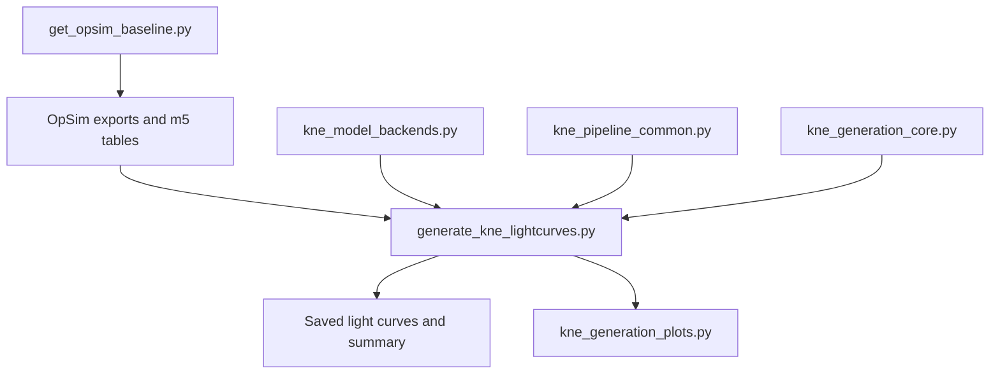

# Reviewable pipeline architecture

This document separates user-facing commands, scientific calculations,
storage transformations, and plotting code. It is intended as a review guide:
the command-line scripts remain convenient entry points, while reusable
modules contain operations that can be tested without launching a simulation.

## Generation path

### Public command

`generate_kne_lightcurves.py` owns the terminal interface and orchestrates one
generation run. Running it as a script preserves the interactive workflow.
Importing it only defines functions and does not prompt, initialize Rubin
bandpasses, create directories, or generate events.

### Scientific backends

`kne_model_backends.py` selects and validates the FIESTA surrogate or
semi-analytical model. Changes here can alter the physical prediction and
therefore require model-level numerical tests.

### Deterministic generation operations

`kne_generation_core.py` contains small transformations of existing arrays or
tables:

- construction of Milky-Way extinction columns and summaries;
- trimming after the last LSST-like detection;
- the inclusive synthetic m5 cut;
- selection of the stored MW-extincted magnitude;
- deterministic derivation of latitude-specific sky seeds.

It deliberately does not import FIESTA, JAX, Astropy, or Rubin. Its functions
receive their inputs explicitly and are covered by small deterministic tests.

### Diagnostic presentation

`kne_generation_plots.py` contains only the figures produced during
generation. It receives already calculated arrays and tables. It does not
draw physical parameters, modify magnitudes, apply depth cuts, classify
detections, or write scientific CSV/Parquet tables.

The extraction was checked on representative synthetic, LSST-like, overlay,
and numerical-floor figures; the before/after PNG arrays were identical pixel
by pixel.

### General shared utilities

`kne_pipeline_common.py` contains format and discovery utilities shared by
several pipeline stages. `kne_m5.py` owns m5-table discovery and percentile
selection. These shared modules avoid maintaining subtly different copies of
the same convention in multiple scripts.

## Analysis path

| Layer | Public entry point | Internal dependencies |
|---|---|---|
| Envelope construction | `build_color_envelopes.py` | `dynamic_color_cut_common.py`, `kne_m5.py` |
| Convergence | `analyze_envelope_population_convergence_fast.py` | `analyze_envelope_population_convergence.py`, `envelope_colour_convergence.py`, `envelope_multiquantile_convergence.py` |
| Saved-result replot | `replot_envelope_population_convergence.py` | `envelope_multiquantile_convergence.py` |
| Realization comparison | `plot_colour_envelope_realizations.py` | `dynamic_color_cut_common.py`, `kne_m5.py` |
| Parameter-space maps | `plot_kne_colour_parameter_space.py` | shared population loaders |
| Iso-colour maps | `plot_kne_colour_isocontours.py` | `plot_kne_colour_parameter_space.py`, `kne_m5.py` |
| Latitude experiment | `run_latitude_experiment.py` | generator, latitude analyzer, comparator |

`analyze_envelope_population_convergence.py` looks like a legacy duplicate,
but it cannot yet be removed: the recommended fast implementation imports
shared constants and aggregation/plotting functions from it. Those utilities
must first move into a neutral module.

## How to review a scientific change

1. Identify the owning module in the tables above.
2. Check whether the change affects physical draws, interpolation, extinction,
   depth selection, statistical validity, or presentation only.
3. Add or update a deterministic test for every changed numerical convention.
4. Run `python -m compileall -q .` and
   `python -m unittest discover -s tests -v`.
5. Compare representative scientific tables before and after the change.
6. For plotting-only changes, compare the underlying plotted values; use
   pixel comparison when exact visual preservation is expected.

## Remaining refactoring order

1. Split the configuration and orchestration sections of
   `generate_kne_lightcurves.py` into explicit runtime objects.
2. Split the large `build_color_envelopes.main()` by responsibility while
   preserving its envelope tables exactly.
3. Move shared convergence utilities out of the legacy entry point.
4. Archive a legacy script only after no public command, import, test, or
   documentation page depends on it.

Reducing line count is not an acceptance criterion by itself. A refactor is
accepted when the public commands remain understandable and deterministic
tests demonstrate that the scientific outputs retain the declared numerical
conventions.
