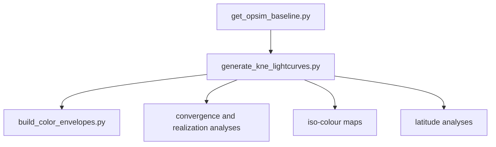

# Reviewable pipeline architecture

The refactoring deliberately favors eight understandable product-producing
scripts over a large collection of thin wrappers. A reviewer can open the
script named in a figure or table and find three labelled concerns in the same
file:

1. user-friendly terminal configuration;
2. scientific calculations and validation;
3. figure and table generation.

## Data flow



The convergence branch contains
`analyze_envelope_population_convergence_fast.py` and
`plot_colour_envelope_realizations.py`. The parameter-space branch is
`plot_kne_colour_isocontours.py`. Latitude products are owned by
`analyze_kne_latitude.py`; `run_latitude_experiment.py` coordinates a complete
paired generation-and-analysis study.

## Terminal and programmatic use

Public use is intentionally simple:

```bash
python SCRIPT.py
```

There is no parallel interface made of long terminal options. For controlled
workflow composition, each script exposes a default configuration and a run
function receiving an `argparse.Namespace`. This is how the latitude
orchestrator calls generation and analysis: directly in Python, without
constructing subprocess commands.

Importing a public script must not prompt, load a FIESTA model, create a run,
or write a figure. Tests enforce this boundary.

## Shared definitions

Five small modules prevent duplication of scientific conventions:

| Module | Shared definition |
|---|---|
| `kne_pipeline_common.py` | data formats, OpSim quantities and posterior loading |
| `kne_population_io.py` | population storage discovery and metadata selection |
| `kne_m5.py` | depth scenarios and m5 table lookup |
| `kne_envelope_core.py` | envelope stages, tails and bootstrap-support rules |
| `dynamic_color_cut_common.py` | colour matching and bootstrap utilities |

They are libraries, not commands. Calculations used by only one workflow were
moved back into that public script, including model backends, plots,
convergence variants, iso-colour population transforms, and latitude methods.

## Latitude ownership

`analyze_kne_latitude.py` contains three explicit scientific sections:

- availability and losses inside one population;
- paired bootstrap comparison of disjoint bins;
- stability of a moving low/high cut.

`run_latitude_experiment.py` is orchestration rather than a fourth latitude
statistic. It creates/resumes paired populations, supplies explicit Python
configurations, validates intermediate products, and requests the paired-bin
comparison. Its plan-only menu choice performs no writes.

## Scientific invariants

The refactoring preserves these review-critical rules:

- interpolation uses supported positive times and never extrapolates;
- the largest convergence sample is the reference;
- nested samples remain reproducible;
- m5 cuts require both colour bands;
- bootstrap uncertainty and tail support remain distinct criteria;
- unsupported iso-colour cells remain masked after smoothing;
- latitude-bin populations reuse one intrinsic catalogue and event identifiers.

## Validation

Run:

```bash
python -m compileall -q .
python -m unittest discover -s tests -v
```

Optional tests that require local FIESTA assets remain opt-in. Generated data
are not test fixtures unless a small deterministic fixture is explicitly
versioned under `tests/`.
