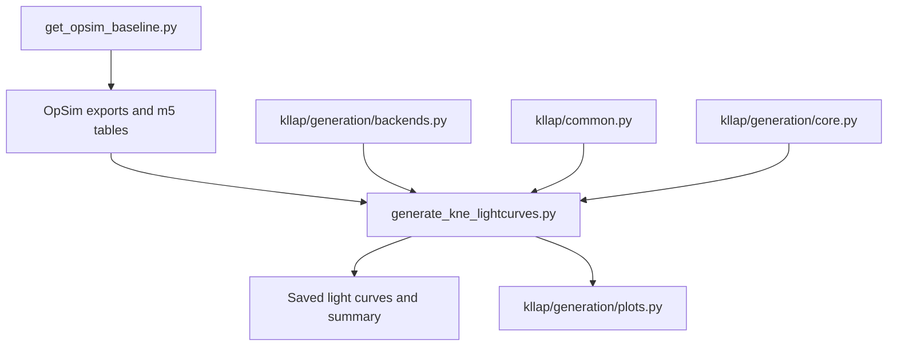

# Reviewable pipeline architecture

This document separates user-facing commands, scientific calculations,
storage transformations, and plotting code. It is intended as a review guide:
the command-line scripts remain convenient entry points, while reusable
modules contain operations that can be tested without launching a simulation.

The repository root is intentionally restricted to stable public commands.
Each is a short wrapper around the corresponding domain implementation:

| Root command | Implementation |
|---|---|
| `get_opsim_baseline.py` | `kllap/opsim/command.py` |
| `generate_kne_lightcurves.py` | `kllap/generation/command.py` |
| `build_color_envelopes.py` | `kllap/envelope/command.py` |
| `analyze_envelope_population_convergence_fast.py` | `kllap/convergence/command.py` |
| `plot_colour_envelope_realizations.py` | `kllap/colour/realizations.py` |
| `plot_kne_colour_isocontours.py` | `kllap/colour/isocontours.py` |
| `run_latitude_experiment.py` | `kllap/latitude/experiment.py` |
| `analyze_kne_latitude.py` | `kllap/latitude/cli.py` |

## Generation path

### Public command

`kllap/generation/command.py` orchestrates one generation run and uses
the terminal functions from `kllap/generation/cli.py`. The root wrapper
`generate_kne_lightcurves.py` preserves the interactive workflow.
Importing it only defines functions and does not prompt, initialize Rubin
bandpasses, create directories, or generate events.

The three main commands have dedicated interface modules:

| Public command | Terminal-only module |
|---|---|
| `get_opsim_baseline.py` | `kllap/opsim/cli.py` |
| `generate_kne_lightcurves.py` | `kllap/generation/cli.py` |
| `build_color_envelopes.py` | `kllap/envelope/cli.py` |

These modules contain parsers, menus, and validation of option combinations.
They do not import Rubin, FIESTA, JAX, Astropy, or plotting libraries. Public
wrappers reexport the historical function names so existing commands and
external imports continue to work.

### Scientific backends

`kllap/generation/backends.py` selects and validates the FIESTA surrogate or
semi-analytical model. Changes here can alter the physical prediction and
therefore require model-level numerical tests.

### Deterministic generation operations

`kllap/generation/core.py` contains small transformations of existing arrays or
tables:

- construction of Milky-Way extinction columns and summaries;
- trimming after the last LSST-like detection;
- the inclusive synthetic m5 cut;
- selection of the stored MW-extincted magnitude;
- deterministic derivation of latitude-specific sky seeds.

It deliberately does not import FIESTA, JAX, Astropy, or Rubin. Its functions
receive their inputs explicitly and are covered by small deterministic tests.

### Diagnostic presentation

`kllap/generation/plots.py` contains only the figures produced during
generation. It receives already calculated arrays and tables. It does not
draw physical parameters, modify magnitudes, apply depth cuts, classify
detections, or write scientific CSV/Parquet tables.

The extraction was checked on representative synthetic, LSST-like, overlay,
and numerical-floor figures; the before/after PNG arrays were identical pixel
by pixel.

### General shared utilities

`kllap/common.py` contains format and discovery utilities shared by
several pipeline stages. `kllap/m5.py` owns m5-table discovery and percentile
selection. These shared modules avoid maintaining subtly different copies of
the same convention in multiple scripts.

`get_opsim_baseline.py` follows the same import-safety rule as the generator:
importing it does not parse terminal input, locate the Rubin database, or
create export products. Its completed depth and revisit tables are presented
by `kllap/opsim/plots.py`; database and sky-selection code does not call
Matplotlib directly.

### Envelope construction

`build_color_envelopes.py` remains the user-facing command and orchestration
layer; its parser and menus live in `kllap/envelope/cli.py`.
`kllap/envelope/core.py` owns the numerical conventions shared with the
convergence and parameter-space analyses: MW extinction, reproducible nested
subsets, bootstrap percentile validity, tail support, and selection of the
widest valid symmetric envelope.

`kllap/population_io.py` owns discovery of Parquet shards or legacy CSV files
and the metadata/latitude selection. It deliberately performs no colour,
depth, bootstrap, or plotting calculation. Analysis commands can therefore
read the saved population without importing the envelope command as their
storage backend.

`kllap/envelope/population.py` owns the next scientific step: interpolation at
fixed bin centres and construction of native colour tracks. It uses only the
saved temporal support, never extrapolates, and does not decide m5 or
statistical validity. Those decisions remain visible in
`build_stage_matrix()` and `build_stage_rules()` respectively.

`kllap/envelope/plots.py` receives already computed tracks and envelope tables.
It cannot select events, calculate percentiles, apply extinction, or impose an
m5 cut. `kllap/envelope/product_plots.py` assembles the complete stage,
AT2017gfo, SN Ia, permanent-exit, and two-survey figures from those primitives.
Neither plotting module owns interpolation or statistical validity.
Representative figures produced before and after extraction were identical
pixel by pixel.

The builder's orchestration exposes explicit functions for argument and time-
grid validation, paired-system dispatch, the four scientific stage masks, and
per-bin bootstrap rule construction. A deterministic 12-event golden test
protects the emitted rules, support diagnostics, event split, and stage
summary while the remaining I/O orchestration is reviewed.

## Analysis path

| Layer | Public entry point | Internal dependencies |
|---|---|---|
| Envelope construction | `build_color_envelopes.py` | `kllap/population_io.py`, `kllap/envelope/population.py`, `kllap/envelope/core.py`, `kllap/envelope/product_plots.py`, `kllap/colour/common.py`, `kllap/m5.py` |
| Convergence | `analyze_envelope_population_convergence_fast.py` | `kllap/convergence/common.py`, `kllap/envelope/core.py`, `kllap/convergence/colour.py`, `kllap/convergence/multiquantile.py` |
| Realization comparison | `plot_colour_envelope_realizations.py` | `kllap/colour/common.py`, `kllap/m5.py` |
| Iso-colour maps | `plot_kne_colour_isocontours.py` | `kllap/colour/population.py`, `kllap/m5.py` |
| Latitude experiment | `run_latitude_experiment.py` | generator, unified latitude analyzer |
| Latitude analysis | `analyze_kne_latitude.py` | `kllap/latitude/population.py`, `kllap/latitude/comparison.py`, `kllap/latitude/plateau.py` |

Named m5 scenarios (`worst_p25`, `median_p50`, and `best_p75`) are owned by
`kllap/m5.py`. Commands may choose different defaults, but they must not carry a
private copy of the allowed names or percentile values. Likewise, the four
photometric envelope stages are owned by `kllap/envelope/core.py`.

The single-load convergence command is the only convergence entry point.
Its `last-edge` mode was compared end to end with the removed subprocess
workflow on the deterministic fixture: all common raw and summary columns
were identical. Shared aggregation and plotting definitions live in
`kllap/convergence/common.py`.

## How to review a scientific change

1. Identify the owning module in the tables above.
2. Check whether the change affects physical draws, interpolation, extinction,
   depth selection, statistical validity, or presentation only.
3. Add or update a deterministic test for every changed numerical convention.
4. Run `python -m compileall -q .` and
   `python -m unittest discover -s tests -v`.
5. Compare representative scientific tables before and after the change.
6. For plotting-only changes, compare the underlying plotted values; use
   pixel comparison when exact visual preservation is expected.

## Remaining refactoring order

1. Keep the golden-output fixture whenever population I/O or stage-product
   orchestration changes.
2. Move additional output families only when doing so gives a clear review
   boundary and preserves the reference tables.
3. Remove another script only after the inventory documents its replacement
   and no command, import, test, or documentation page depends on it.

Reducing line count is not an acceptance criterion by itself. A refactor is
accepted when the public commands remain understandable and deterministic
tests demonstrate that the scientific outputs retain the declared numerical
conventions.
